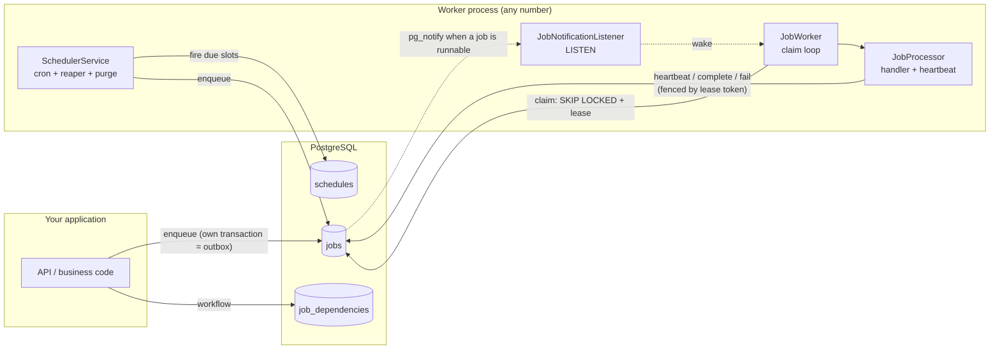
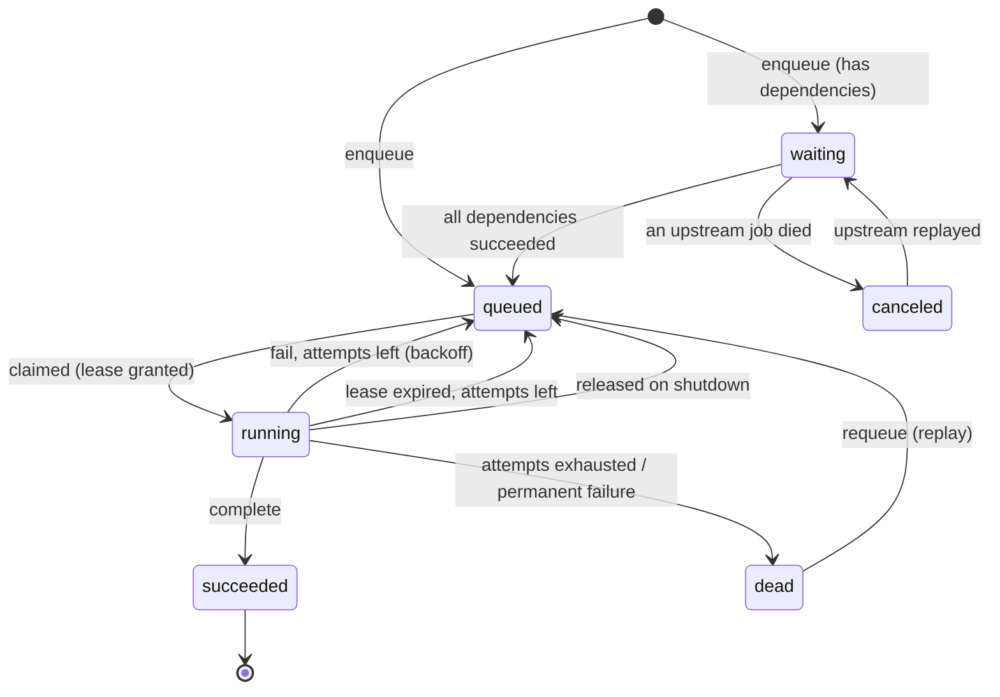

# durable-job-engine

[](https://github.com/melvinbagnes/durable-job-engine/actions/workflows/ci.yml)

A durable background-job and workflow engine for .NET, built on nothing but PostgreSQL. No broker, no Redis: the database is the queue, the lock service, the scheduler and the outbox.

It exists to answer one question properly: **what has to be true for a job queue to survive crashes, concurrent workers and retries without losing or double-running work?** Every behaviour below is covered by a test that runs against a real PostgreSQL server.

| Capability | How it works |
|---|---|
| **Safe parallel workers** | `FOR UPDATE SKIP LOCKED` claim; concurrent workers always get disjoint jobs |
| **Crash recovery** | Time-limited *leases* with heartbeats; an abandoned job is reclaimed automatically |
| **Zombie protection** | Every lease carries a *fencing token*; a stalled worker that wakes up late cannot overwrite the new owner's result |
| **Retries** | Exponential backoff with cap and jitter, per-job attempt budget |
| **Dead-letter + replay** | Exhausted or permanently failed jobs park in `dead`; `RequeueDead` replays them |
| **Idempotent enqueue** | Unique idempotency key; N concurrent enqueues with the same key create exactly one job |
| **Transactional outbox** | Enqueue inside *your* transaction; the job exists if and only if your business change commits |
| **Workflows (DAGs)** | Steps with dependencies; failures cancel downstream steps, replay revives them |
| **Instant wake-up** | PostgreSQL `LISTEN/NOTIFY` wakes idle workers the moment a job becomes runnable; polling stays as a backstop |
| **One clock** | Leases, delays and cron slots are all timed by the database server's clock, so skewed worker clocks cannot disagree |
| **Cron schedules** | 5-field cron in UTC or any IANA time zone, with defined DST behaviour; safe with many scheduler processes, one job per slot |
| **Graceful shutdown** | In-flight jobs are released back to the queue without spending an attempt |

## Architecture



### Job lifecycle



## Design decisions

**Claiming.** One statement selects candidates with `FOR UPDATE SKIP LOCKED`, increments `attempts`, issues a fresh `lease_token` and sets `lease_expires_at`. Workers never wait on each other's rows, and a job can only be in one worker's hands. Ordering is `priority DESC, run_at, created_at`, served by a partial index on queued rows.

**Leases instead of "running" flags.** A flag cannot tell a busy worker from a dead one. A lease can: the worker extends it every third of the lease duration; if it stops, the claim query itself treats the job as claimable again. No separate janitor is needed for the common case (a job on its final attempt whose lease expired cannot be claimed again, so a reaper moves it to `dead` instead of leaving it in `running` forever).

**Fencing.** Reclaiming gives the job a *new* `lease_token`, and `complete`, `fail`, `release` and `heartbeat` all include `WHERE lease_token = @token`. A worker that was paused (GC, network partition, VM freeze) and wakes up after its job was reassigned gets "0 rows" and its result is discarded. The heartbeat also cancels the handler's `CancellationToken` when it notices the lease is gone. This protects the *job row*; it cannot undo side effects your handler already performed, so handlers must be idempotent (see below).

**Delivery semantics: at-least-once.** A job can run more than once (crash after the side effect, before `complete`). Handlers receive `Attempt` and the job id so they can de-duplicate downstream. The engine gives you *exactly-once enqueue* (idempotency keys) and *exactly-once state transitions* (fencing), not exactly-once side effects, which no queue can promise.

**Retries.** `delay = min(max, base * 2^(attempt-1))` with symmetric jitter, so a failing dependency is not hammered in lockstep. `PermanentFailureException` skips the remaining attempts for errors that retrying cannot fix (bad payload, unknown job type).

**Idempotency keys.** A partial unique index plus `INSERT ... ON CONFLICT DO NOTHING RETURNING id`. Under contention the losers block on the winner's row and then read the original job id back, so twenty simultaneous requests produce one job (tested). Keys live as long as the job row; set `CompletedRetention` to release old ones.

**Transactional outbox.** `JobStore.EnqueueAsync(transaction, request)` writes the job through *your* connection and transaction. There is no dual-write problem: either both your order row and its confirmation-email job commit, or neither does. The `jobs` table is the outbox and the workers are the relay, which is why this needs no CDC or separate outbox table.

**Workflows.** Steps are validated (unique keys, known dependencies, no cycles, Kahn's algorithm) and inserted in one transaction: roots as `queued`, the rest as `waiting`. When a job succeeds, dependents whose parents have *all* succeeded become `queued`. A permanently failed job cancels its whole downstream subtree (recursive CTE); `RequeueDead` revives it.

> **A race worth knowing about.** If two parents of the same child finish at the same moment, each transaction sees the other parent as "still running", so neither promotes the child and it waits forever. I reproduced this against PostgreSQL with two concurrent transactions (the child was stuck in 3 of 6 rounds of my reproduction). The fix is to lock the waiting children (`FOR UPDATE`, in id order to avoid deadlocks) before checking, which serialises the check so the second transaction sees the first one's commit. `Workflow_TwoParentsFinishingTogether_AlwaysReleaseTheChild` guards it.

**Waking idle workers.** An idle worker waits on a signal with `PollInterval` as the timeout. Every statement that makes a job runnable *now* (enqueue, a dependency completing, a shutdown release, a replay) also runs `pg_notify`, and a dedicated listener connection sets the signal. Because `pg_notify` inside a transaction is delivered on commit, an outbox job inside *your* transaction wakes workers only if your transaction commits. The signal is a latch, so a notification that arrives while the worker is busy is not lost. NOTIFY is an optimisation, not something correctness depends on: a dropped listener connection is retried, the first reconnect wakes the worker once, and polling keeps picking up work (including delayed jobs and retries, whose due time arrives with no event).

**One clock.** Lease expiry, `run_at`, retry backoff and cron slots are all computed from `clock_timestamp()` on the database server, not from each worker's clock. Two workers whose clocks disagree by minutes still agree on whether a lease has expired. A `TimeProvider` is used only if you register one (the store tests do, to fast-forward time).

**Cron.** A small, dependency-free 5-field parser (`*`, lists, ranges, steps, `7` = Sunday, classic day-of-month/day-of-week OR rule). Each schedule row is taken with `SKIP LOCKED`, and every slot's job carries the idempotency key `schedule:{name}:{slot}`, so any number of scheduler processes produce one job per slot. After downtime, missed slots fire **once**, not once per missed slot. Re-registering an unchanged schedule on redeploy keeps its next slot; changing the expression or the time zone recomputes it.

**Cron and time zones.** `RecurringJobDefinition.TimeZone` takes an IANA id (`"Asia/Manila"`, `"America/New_York"`); null means UTC. Daylight saving is handled with two explicit rules:

- A schedule that runs in *every* hour (`*/10 * * * *`, `0 * * * *`) follows real elapsed time: nothing is skipped when clocks jump forward, and the repeated hour in autumn runs again.
- A schedule that *names* hours (`30 2 * * *`) runs once per wall-clock day. A time that does not exist (02:30 on the spring-forward day) runs at the same instant shifted past the gap (03:30); a time that happens twice (01:30 in autumn) runs at its first occurrence only.

Both are covered by tests against `America/New_York` on the 2026 transition dates. Zone data comes from the operating system, so a container image without `tzdata` fails at startup with `TimeZoneNotFoundException` instead of silently running at the wrong hour.

## Quick start

```bash
docker compose up --build        # PostgreSQL 16 + the demo API on :8080
```

Then use [`requests.http`](requests.http), or:

```bash
# A job that fails twice, then succeeds: watch the backoff in the logs
curl -X POST localhost:8080/jobs -H 'content-type: application/json' \
  -d '{"type":"email.send","queue":"emails","payload":{"to":"ana@example.com","failFirst":2}}'

# Order + confirmation e-mail in one transaction (outbox)
curl -X POST localhost:8080/orders -H 'content-type: application/json' \
  -d '{"customer":"ana","amount":1499.5}'

curl localhost:8080/stats
```

`scripts/smoke.sh` runs this whole tour (retry, idempotency, dead-letter and replay, workflow order, cycle rejection, outbox, stats) against the running stack and fails on any deviation. CI runs it on every push against a fresh `docker compose up --build`.

### Using it

```csharp
builder.Services
    .AddJobEngine(options =>
    {
        options.ConnectionString = connectionString;
        options.Queues = ["default", "emails"];
        options.Concurrency = 4;
        options.RetryPolicy = new RetryPolicy(TimeSpan.FromSeconds(5), TimeSpan.FromMinutes(30));
    })
    .AddHandler<SendEmailHandler>("email.send")                       // class handler, resolved per job scope
    .AddHandler("cache.warm", (ctx, ct) => WarmAsync(ct))            // or a delegate
    .AddRecurring(new RecurringJobDefinition("nightly", "0 3 * * *", "report.generate"));

// Anywhere (an API process can run with EnableWorker = false)
await store.EnqueueAsync(new EnqueueRequest { Type = "email.send", IdempotencyKey = $"welcome:{userId}" });

// Inside your own transaction (outbox)
await store.EnqueueAsync(transaction, new EnqueueRequest { Type = "email.send" });

// Workflow
await store.EnqueueWorkflowAsync(
[
    new WorkflowStep { Key = "extract", Type = "etl.extract" },
    new WorkflowStep { Key = "load", Type = "etl.load", DependsOn = ["extract"] }
], idempotencyKey: "etl-2026-01-01");
```

## Tests

104 tests. `dotnet test` needs a PostgreSQL server (`JOBENGINE_TEST_CONNECTION`, default `postgres/postgres@localhost:5432`); `docker compose up -d db` provides one. Each test gets its own schema. Store tests use a fake clock so leases, backoff and cron slots can be fast-forwarded; worker tests run the real hosted services with the real clock.

| What is proven | Test |
|---|---|
| 8 concurrent workers claim 200 jobs with no duplicates and no losses | `ConcurrentWorkers_NeverClaimTheSameJob` |
| 20 concurrent enqueues with one key create one job | `ConcurrentEnqueuesWithTheSameKey_CreateExactlyOneJob` |
| Expired lease is reclaimed; the stale holder is fenced out of heartbeat, complete and fail | `ExpiredLease_IsReclaimed_AndTheStaleHolderIsFencedOut` |
| Heartbeat keeps a long job from running twice | `Heartbeat_KeepsALongRunningJobFromBeingReclaimed`, `Worker_Heartbeat_KeepsALongJobFromBeingRunTwice` |
| Backoff, attempt budget, dead-letter, replay | `FailedJob_IsRetriedWithBackoff_ThenDeadLettered`, `DeadJob_CanBeRequeuedWithAFreshAttemptBudget` |
| A crashed worker's job is picked up by another worker | `Worker_PicksUpAJobAbandonedByACrashedWorker` |
| Shutdown releases in-flight jobs without spending an attempt | `Worker_ShutdownReleasesRunningJobsWithoutSpendingAnAttempt` |
| A handler whose lease was taken is cancelled | `Worker_CancelsAHandlerWhoseLeaseWasTakenAway` |
| Outbox rolls back with the caller's transaction | `EnqueueInsideACallersTransaction_RollsBackWithIt` |
| Diamond workflow order, failure cascade, replay, parent race | `Workflow_*` |
| Two schedulers tick the same slot: one job; missed slots fire once | `Schedule_*` |
| Cron in a time zone: fixed offsets, DST gap, repeated hour, every-10-minutes across both transitions | `CronExpressionTests.TimeZone_*`, `Schedule_WithATimeZone_*` |
| An idle worker with a 60 s poll interval runs a new job in well under a second; without NOTIFY it does not | `Notify_*`, `WithoutNotify_*` |
| NOTIFY also fires when a dependency completes, and only after an outbox transaction commits | `Notify_WakesTheWorkerWhenADependencyCompletes`, `Notify_FromACallersTransaction_*` |
| Delayed jobs still run on time through the polling backstop | `DelayedJob_RunsOnceDue_EvenWithNoNotificationForIt` |
| Timestamps come from the database clock | `DatabaseClockTests` |
| Cron parsing and next-occurrence maths, retry maths, DAG validation | `CronExpressionTests`, `RetryPolicyTests`, `WorkflowGraphTests` |

## Benchmarks

`benchmarks/JobEngine.Benchmarks` runs in CI against PostgreSQL 16 and writes its table to the job summary. The run these numbers come from (GitHub-hosted runner, 4 logical cores, PostgreSQL and workers on the same machine, 20,000 jobs per throughput run, no-op handler):

| Measurement | Result |
|---|---|
| Enqueue, 8 parallel producers | 5,425 jobs/s |
| Drain, 1 worker, concurrency 16 | 1,001 jobs/s |
| Drain, 4 workers x concurrency 16 | 1,418 jobs/s |

Idle-to-running latency (job enqueued while the worker is idle, poll interval 1 s, 100 samples with NOTIFY and 30 with polling only):

| Mode | p50 | p95 | max |
|---|---|---|---|
| LISTEN/NOTIFY | 2 ms | 3 ms | 10 ms |
| Polling only | 821 ms | 939 ms | 940 ms |

How to read these: the database and all workers share four cores, so four workers are only about 1.4x faster than one; the database is the bottleneck, which is the design's expected limit. Absolute numbers on a shared CI runner vary from run to run and say nothing about dedicated hardware. They are a measured floor for a no-op handler, not a capacity claim, and I did not compare against other queues.

Run it yourself: `JOBENGINE_TEST_CONNECTION=... dotnet run -c Release --project benchmarks/JobEngine.Benchmarks`.

## Layout

```
src/JobEngine/            the library
  Storage/Sql.cs          every statement, in one reviewable file
  Storage/JobStore.cs     state transitions (each one a statement or a short transaction)
  Runtime/                JobWorker (claim loop), JobProcessor (handler + heartbeat), SchedulerService,
                          JobNotificationListener + WakeSignal (LISTEN/NOTIFY)
  Scheduling/             CronExpression (UTC and time zones), RetryPolicy
  Workflows/              DAG validation
src/JobEngine.Demo/       minimal API: jobs, workflows, outbox, stats, replay
tests/JobEngine.Tests/    unit tests + PostgreSQL integration tests
benchmarks/               throughput and wake-up latency benchmark (runs in CI)
scripts/smoke.sh          end-to-end check of the demo API against docker compose
```

## Limits

What is still not covered, stated plainly:

- **Delayed jobs and retries are found by polling.** NOTIFY fires when a job becomes runnable now. A job scheduled for 30 seconds from now, or a retry waiting out its backoff, has no event at the moment it comes due, so it starts within `PollInterval` (1 s by default) of its due time.
- **LISTEN needs a session-level connection.** Through PgBouncer in transaction-pooling mode, `LISTEN` does not work; point `ConnectionString` at PostgreSQL directly or set `UseListenNotify = false` and accept polling latency. Channels are database-wide, so give environments that share a database different `NotificationChannel` values.
- **The database clock is the single source of time**, which assumes one writable primary. It removes worker clock skew; it does not help if you fail over to a replica whose clock is badly off.
- **Cron has minute resolution** and no seconds field. DST behaviour is the two rules above, not a configurable policy.
- **No per-job timeout or rate limiting.** A handler that never returns holds its slot; the heartbeat keeps its lease alive. Pass the supplied `CancellationToken` into everything you await.
- **Throughput is bounded by PostgreSQL** (see the benchmark). For hundreds of thousands of jobs per minute use a log-based broker.
- **One `jobs` table.** No partitioning; use `CompletedRetention` to keep it small.
- **Verified on PostgreSQL 16 on Linux only.** The tests, benchmark and docker smoke test all run there; other versions and Windows are untested.

## License

All rights reserved. The source is public so it can be read and evaluated (for example by recruiters and hiring managers); copying, modifying or reusing it requires the author's written permission. See [LICENSE](LICENSE).
